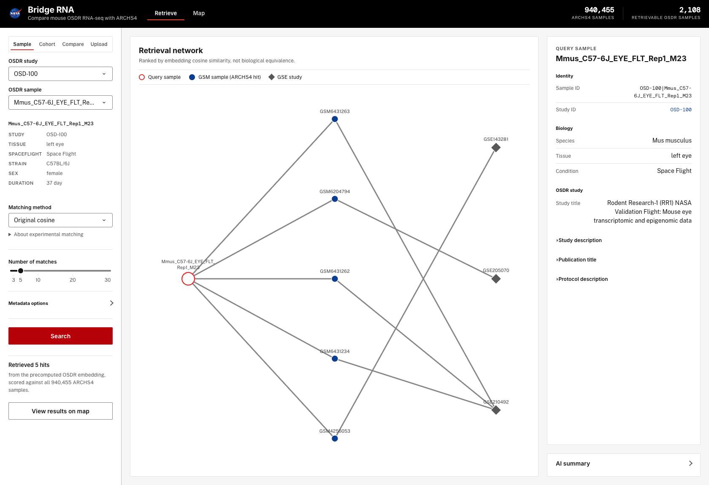
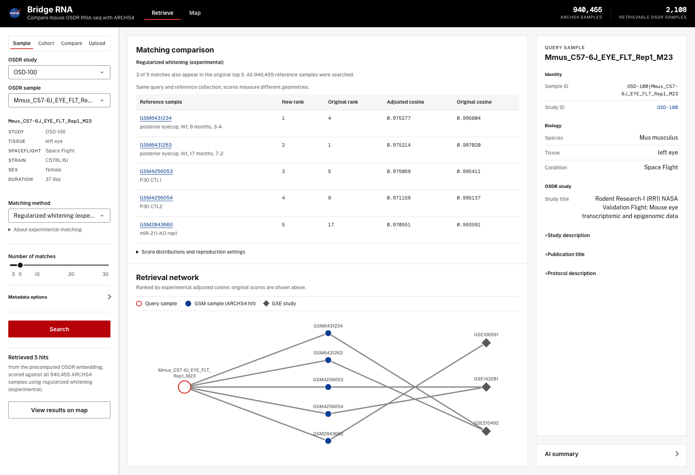
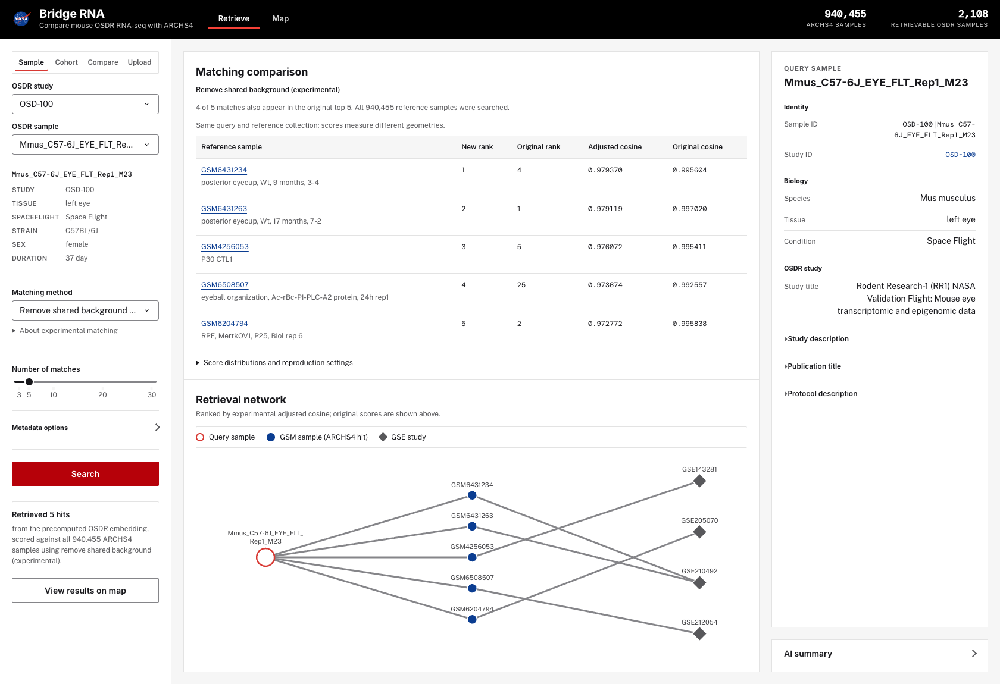
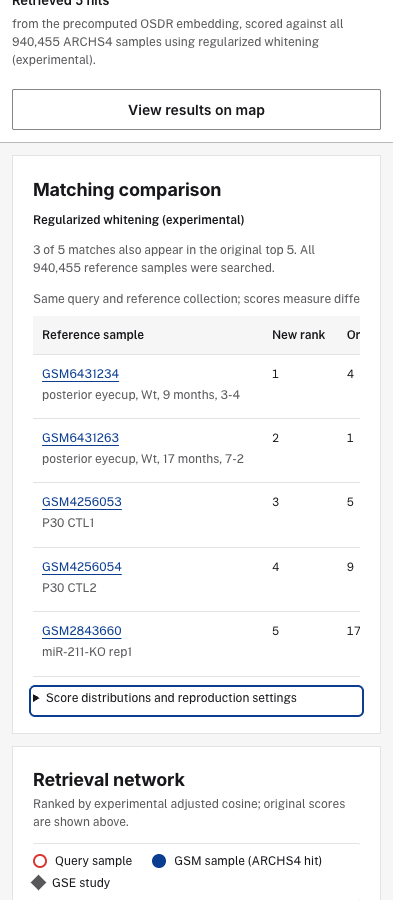

# Experimental matching corrections

Single-sample retrieval now offers original cosine (the default), shared-background
removal, and regularized whitening. Both experiments search the complete existing
940,455-row reference collection. They change rankings, not only the displayed
scale. They do not establish biological equivalence, calibrated probability,
statistical significance, or better perturbation retrieval.

## Try it

Select an OSDR sample in **Sample**, choose **Matching method**, and press
**Search**. The matching comparison shows the adjusted rank and cosine alongside
each hit's original full-index rank and cosine. Source GSM links remain available.
The disclosure gives full-reference score percentiles, the top-k ranges, fitting
parameters, and source checksums. Choosing original cosine and searching again
restores the existing retrieval path exactly. A changed selection takes effect on
the next search; the result panel names the method that actually ran.

Cohort, upload, and fixed flight/ground comparisons continue to use original
cosine. The selector is inside the Sample panel. Experiments require an existing
cached OSDR embedding. Missing artifacts or unsupported samples produce an error,
never a silent fallback. The original route works without correction artifacts.

Map coordinates and projection algorithms are unchanged. Corrected matches and
their 250-row neighborhood retain row identities, original scores/ranks, and
method provenance on the map; hover and sample details distinguish adjusted
cosine. Map proximity does not determine corrected retrieval rank. AI context
also carries the method and original cosine and warns against interpreting
greater numerical spread as validated biological improvement.

## Reproduce locally

With the existing reference files and OSDR caches available:

```sh
python -m precompute.build_matching_corrections
python -m precompute.validate_matching_corrections
python app.py --host 127.0.0.1 --port 8068
python -m pytest -q
python tests/e2e_matching.py --url http://127.0.0.1:8068
```

The builder writes only `cache/matching_corrections.npz` (about 18 MB), which is
ignored by git. It does not rewrite embeddings, metadata, coordinates, or model
weights. The artifact stores transforms and per-row transformed norms, rather
than a second full embedding index. A SHA-256 gate checks the source embedding
file and sample-location metadata on first load, and reloads when file size or
modification time changes. The artifact is created offline, not during a search.

## Exact methods

1. L2-normalize reference embeddings using the existing float32 input precision.
2. Select 50,000 reference rows uniformly without replacement, with seed
   `20261015`. No OSDR query or flight/ground labels participate in fitting.
3. Compute the reference mean and sample covariance in float64.
4. Apply the same fitted transform to every normalized reference and query:
   - **Background removal:** subtract the mean and project away the single
     largest covariance eigenvector, following the all-but-the-top approach.
   - **Regularized whitening:** subtract the mean and apply symmetric ZCA
     scaling. Each covariance eigenvalue is floored at 1% of the largest before
     inverse-square-root scaling. This is an independent alternative to
     background removal and retains the leading component. The floor limits
     amplification of low-variance directions; it is not a biologically
     optimized hyperparameter or exact identity-covariance whitening.
5. L2-normalize the transformed vectors and calculate cosine similarity.

For transform `W`, centered reference `x` and centered query `q`, the scorer uses
`x · (W Wᵀ q) / (||xW|| ||qW||)`. This equals explicit transformed cosine while
requiring only one matrix-vector product per reference row at query time. Centered
products use float64 to limit cancellation. Invalid/nonfinite or degenerate
vectors are rejected. Adjusted ties are ordered by reference row index.

Original ranks use full-index scores from the existing scanner, with row-index
tie breaking for the displayed rank. The original scanner's partition-based
top-k behavior is preserved when original cosine is selected. The displayed
top-k overlap uses that original scanner's actual output, including its tie behavior.

Method foundations: [All-but-the-Top](https://arxiv.org/abs/1702.01417) and
[Whitening Sentence Representations](https://arxiv.org/abs/2103.15316). These
papers concern language representations; they are not evidence of RNA retrieval
quality. CSLS and the mentor's separate 50-program biological-state head are not
implemented. The latter requires the trained checkpoint, definitions, compatible
reference vectors, and validation evidence.

## Measured behavior

The [reproducible measurements](validation/matching-corrections.csv) cover the
first cached flight sample in each of six fixed studies, chosen for tissue
coverage before viewing corrected results. Every query still searches the full
reference collection. The reported range is the best-minus-fifth-best score for
each method's own top five, rather than a comparison of identical pairs.

| Study | Original top-five gap | Background gap | Whitening gap | Original five retained by whitening |
|---|---:|---:|---:|---:|
| OSD-100, eye | 0.001609 | 0.006598 | 0.004726 | 3/5 |
| OSD-104, soleus | 0.000223 | 0.003302 | 0.007813 | 1/5 |
| OSD-194, retina | 0.000975 | 0.007980 | 0.009074 | 3/5 |
| OSD-137, liver | 0.000023 | 0.000651 | 0.002713 | 1/5 |
| OSD-102, kidney | 0.000292 | 0.000844 | 0.000397 | 2/5 |
| OSD-613, brain | 0.000611 | 0.011859 | 0.037909 | 0/5 |

This demonstrates numerical separation and reranking, not a better biological
answer. Existing derived tissue categories remain broadly consistent in these
examples, but they are incomplete and are not verified ground truth. For eye,
the Eye category falls from 23/30 original hits to 21/30 after whitening; some
posterior-eyecup hits are categorized Other. Study dominance is mixed: OSD-194's
largest GSE grows from 5/30 to 6/30 after whitening (9/30 after background
removal), while OSD-102's falls from 13/30 to 8/30. GSEs are not necessarily
independent studies or independent biological replication.

Across all twelve real query/method cases, streamed scores agree with explicit
transformation at 97 fixed reference positions with maximum absolute error
`2.95e-8`. Observed corrected searches took about 2–5 seconds on this machine.
The unit suite checks determinism, zero/nonfinite-vector rejection, source
immutability, transformed cosine equivalence, changed-index/metadata rejection,
and score provenance through inspector, AI context, neighborhood, and map.
Browser checks cover both methods, baseline restoration, source links, narrow
layout, keyboard disclosures, mode isolation, and the map.

## Limits and next scientific check

Shared directions can contain real tissue/species biology as well as technical
effects. Removing them can damage useful signal. The reference fit is uniformly
sampled by row, not balanced by study, so overrepresented studies can influence
the geometry. Hardware/precision differences between query and reference
embeddings remain possible confounders. Whitening does not identify or remove
those causes, and this reference collection is not verified to contain only
terrestrial experiments.

These six descriptive examples are not a held-out perturbation benchmark.
Before changing the default, evaluate known tissue and condition labels in
independent held-out studies, test sensitivity to fitting sample, component
count and regularization, examine hubness/study concentration, and include
random-label negative controls. Do not select settings solely to make score
differences larger. No discovery or improvement in biological accuracy is
claimed by this PR.

## Review images





