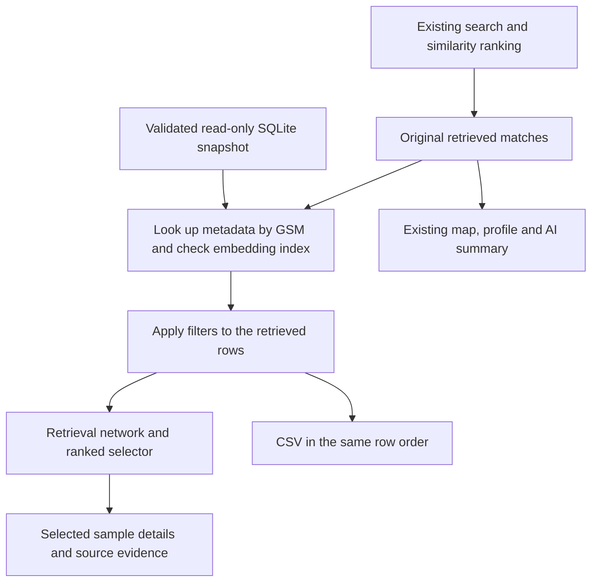

# Bridge RNA metadata upgrade explained

The upgrade adds biological annotations and study context to the ARCHS4 samples
that Bridge RNA already retrieves. You can inspect their sources, filter the
returned matches, and export the visible rows as CSV. Its purpose is to make
existing search results easier to interpret and work with while preserving the
scientific retrieval pipeline.

The implementation is complete and locally validated as of October 6, 2026.
It has not been deployed to production. The application change is commit
`a14529c`; a separate deployment packaging correction is `f774e7d`.

## What was implemented

### Sample details with source attribution

Selecting a retrieved sample now shows organ, disease, treatment, experimental
setting and perturbation in the existing details panel. The existing derived
tissue label remains separately labeled. An organ annotation from a source
database can describe something different from the app's broader tissue category,
so neither overwrites the other.

An expandable **Metadata sources and study context** section provides:

- The source and stored canonical value for each of the five annotations.
- Active source evidence, including raw assertion values, annotation methods,
  evidence references and ontology identifiers when available.
- Recorded conflicts, with both sources and values, their status and notes.
- All associated GEO studies, with titles, summaries, experimental designs,
  PubMed IDs, retrieval dates and source hashes when present.
- Available sample treatment protocols, growth protocols and descriptions.
- GEO accession links and the metadata database's Box link and version.

This uses the app's existing inspector and native expandable sections. It keeps
the primary annotations readable while allowing detailed provenance to be opened
when needed. The existing NCBI lookup remains available when a selected sample
lacks actual study context; study membership alone does not suppress that lookup.

### Filtering the retrieved matches

Five dropdown filters were added: **organ, disease, treatment, experimental
setting and study accession**. Each offers values found in the current retrieved
set, including **Unknown** where applicable. Perturbation is displayed and
exported but does not have its own filter in this update.

Filters combine with AND. Selecting an organ and a study retains samples matching
both; a sample matches a study if any of its study memberships matches. The
interface shows **X of Y matches shown**, offers **Reset filters**, and clears
filters when a new search runs. An empty selection shows an explanatory state
and disables export.

For example, if a search retrieves 30 samples and four have the chosen organ,
filtering shows those four in their original similarity order. It does not find
the 30 closest samples with that organ across the whole collection. There may
be relevant samples beyond the original retrieved set that this filter cannot show.

The filter updates the retrieval network, ranked-match selector and CSV. The
map, similarity profile and AI summary retain the complete search. This behavior
is stated beside the controls to make the different scopes explicit.

### Ranked selection and CSV export

A **Ranked matches** selector provides a direct way to inspect each visible
sample without clicking a network node. Original rank numbers are retained after
filtering; a sample originally ranked 26 remains rank 26.

**Export CSV** downloads `bridge-rna-matches.csv` from the same ordered rows used
by that selector. It includes:

| Contents | Exported fields |
| --- | --- |
| Identity and retrieval | GSM, embedding row index, original rank and similarity score |
| Existing context | Species, derived tissue, existing GSE and sample title |
| New annotations | Organ, disease, treatment, experimental setting and perturbation, each with source and stored value |
| Detailed evidence | Study memberships, sample context, conflicts and active assertions as JSON cells |
| Snapshot provenance | Box file ID and version |

For existing cohort comparisons, shared samples appear once. Ordering is cohort
A's ranking followed by B-only samples in B's ranking. Both arms' original ranks
and scores are exported, without calculating a new combined similarity score.
Numeric score precision is preserved. Formula-leading text receives a protective
apostrophe so source annotations are not interpreted as spreadsheet formulas.

## What it uses

### The verified metadata snapshot

The database is the user-supplied file at
`/Users/josh/Downloads/bridge_metadata.sqlite`, identified through the earlier
Box comparison report. The earlier MCP download problem was bypassed by the
user's download. No Box original was modified, and the implementation did not
make another copy of the large file.

| Snapshot property | Verified value |
| --- | --- |
| Box file ID | `2499909479489` |
| Box version | `2773286356289` |
| File size | 4,371,132,416 bytes |
| SHA-1 | `b207d54b15a3a21f662cd78407794731fe338c85` |
| Assertion schema version | `bridge-metadata-v1` |

The app reads the database's existing canonical annotations. It does not choose
new canonical values or recompute the database's source reconciliation rules.
Organ and disease values come from GEOMeta and Gemma; treatment values come from
Gemma; experimental setting and perturbation come from GEOMeta. Study and sample
context come from the database's GEO records. These source names are retained
from the snapshot rather than treated as interchangeable evidence.

The relevant database tables are:

| Table | Purpose in this upgrade |
| --- | --- |
| `samples` | Match GSM accessions to the existing embedding indices |
| `canonical_metadata` | Read the selected annotation values and their sources |
| `metadata_assertions` | Read active evidence for the five displayed fields |
| `sample_studies` and `studies` | Collect all study memberships and context |
| `metadata_conflicts` | Preserve recorded disagreements |
| `geo_sample_extras` | Read available protocols and descriptions |

### Existing application components and dependencies

The implementation uses **Python's built-in SQLite, CSV and JSON libraries**, the
existing **Dash** interface and callbacks, and the existing **Plotly** network
figures. Validation uses the project's existing **pandas and NumPy** dependencies.
Verification uses **pytest and Playwright**. No new runtime dependency, database
server, background worker or frontend framework was added.

There is no new LLM annotation or interpretation step. Assertions marked
`validation_only` in the database are excluded from the active evidence displayed
by this feature. Existing AI functionality remains separate.

| File | Responsibility |
| --- | --- |
| [result_metadata.py](../bridge_rna/result_metadata.py) | Read-only lookup, file receipt checks, identity checks and source records |
| [results.py](../bridge_rna/results.py) | Ordered sample rows, exact filtering and CSV serialization |
| [results_ui.py](../bridge_rna/results_ui.py) | Controls, sample selection, source disclosures and export callbacks |
| [panels.py](../bridge_rna/panels.py), [layout.py](../bridge_rna/layout.py), [callbacks.py](../bridge_rna/callbacks.py) | Connect metadata to the existing results and inspector |
| [retrieve.css](../assets/retrieve.css) | Small layout additions using the existing visual styles |
| [validate_result_metadata.py](../precompute/validate_result_metadata.py) | Offline integrity, schema, coverage and complete sample-mapping validation |

Deployment preflight and the runtime allowlist were extended to include the
new modules and validation utility. The pre-existing `profile.py` module was
also added to the allowlist because clean staging exposed its omission.

## How it works and why

**Metadata is added after retrieval.** The original result store is preserved;
separate stores hold the enriched filtered view and its ordered rows. This keeps
annotations and interface choices from changing embeddings, cosine similarity,
retrieval ranking, cohort pooling or map projections.

**GSM identity is checked against the embedding index.** Full offline validation
compared all 940,455 records with the app's locations parquet using GSM, global
index, species ID, shard index, shard filename and row within the shard. Runtime
lookups check each returned sample again when its embedding index is supplied.
This prevents a metadata row from being attached merely because it occupies a
similar position in another file.

**Study memberships are collected separately.** Canonical metadata has one row
per sample, but 210,140 samples belong to multiple studies. Joining studies into
the primary result table could duplicate samples and distort counts or exports.
Collecting their studies inside each sample's metadata preserves one result row.

**The database is opened read-only and queried for the retrieved IDs.** It is not
loaded into memory at startup. No source rows or indexes are altered, and SQLite's
page cache is capped at 2 MiB per connection. The database remains outside Git;
an eventual server copy belongs in the existing ignored `cache/` storage.

**Expensive validation happens offline.** A JSON receipt records the full hash,
integrity and mapping checks. At runtime, the app compares that receipt with the
file's device, inode, size and modification/change timestamps. This avoids hashing
4.37 GB whenever a filter changes. A missing, malformed or stale receipt disables
additional metadata, displays an unavailable message and leaves the original
retrieval usable. A changed or moved file must be revalidated.

**Missing values and conflicts remain visible.** Exact missing-value markers such
as NA, N/A and NULL become Unknown. Values such as No, Normal, vehicle and untreated
retain their meanings. Stored values and source evidence remain available, and
the 36 recorded conflicts are exposed for affected results rather than resolved
silently by the interface.

## Coverage and limitations

### Available annotations cover only part of the collection

Coverage uses all **940,455 reference samples** as the denominator and excludes
exact missing-value placeholders:

| Field | Samples with usable values | Coverage |
| --- | ---: | ---: |
| Organ | 404,266 | 42.986% |
| Disease | 297,603 | 31.645% |
| Treatment | 94,990 | 10.100% |
| Experimental setting | 438,119 | 46.586% |
| Perturbation | 438,119 | 46.586% |
| Study summary through at least one membership | 931,581 | 99.056% |

The database contains 96,172 non-null treatment entries, but 1,182 contain exact
missing-value markers. That explains the lower usable treatment count.

Coverage is strongly uneven by species. Of 429,746 mouse samples, only 20,063
have organ annotations and 479 have disease annotations; none have experimental
setting annotations. Consequently, metadata filtering can favor well-annotated
human samples. **Unknown means that a usable annotation is absent; it does not
mean healthy, untreated or biologically negative.**

### Source descriptions still require interpretation

Study summaries can describe several experimental groups. A disease or treatment
mentioned in a study summary does not establish that every sample received it.
The validation proves file integrity and sample alignment, not the biological
correctness of each annotation. Recorded conflicts are preserved, but the app
does not independently discover every possible disagreement between sources.

Filters use exact stored categories. There is no synonym expansion, ontology
hierarchy search, free-text protocol search or automatic splitting of compound
terms. Similar descriptions can therefore appear as separate choices.

The new metadata describes retrieved ARCHS4 reference samples. It does not add
new OSDR query studies or revise the query samples' existing metadata. Embedding
cosine similarity still does not establish biological equivalence or causation.

### Filtering and export have a deliberate boundary

Filtering cannot recover samples outside the originally retrieved set. It does
not rerun retrieval within an organ, disease or treatment subset. The map,
similarity profile and AI summary continue to describe the full search, so their
counts or contents can differ from the filtered network and CSV.

The CSV is one row per sample. Detailed study and evidence records are JSON
inside cells; analyzing those nested records may require parsing the JSON.
The `*_raw` columns contain the stored canonical values, while the original
assertion text is in `assertions_json`. Exported source text may begin with a
protective apostrophe. Scores retain full precision even when the interface
shows a rounded number.

### Performance and deployment evidence are local

The local benchmark for 30 real matches measured 23.9 ms for the first metadata
lookup and about 5.0–6.3 ms thereafter with Python allocation tracing enabled.
Peak traced Python allocations were approximately 373 KB. This is not a measure
of total application memory: native SQLite allocations, browser memory and the
existing retrieval engine are outside that figure. The enriched JSON payload
grew from approximately 12 KB to 87 KB for that query.

Lookups are repeated on filter changes and remain bounded by the retrieved set.
Samples with unusually long protocols, summaries or many studies can create
larger responses. Production concurrency and production latency were not load
tested. The file receipt detects ordinary local replacement or modification;
it is not a cryptographic signature protecting against malicious editing of both
the database and receipt.

The snapshot is fixed to the validated Box version. There is no automatic Box
sync or metadata refresh job. Updating it requires explicit validation. Production
activation still requires the documented transfer, server validation and manual
apply/startup procedure; the 4.37 GB database is staged separately from code.

## What was verified

SQLite integrity passed with zero foreign key violations. All 940,455 sample
mappings matched, GSM and embedding indices were unique, and canonical metadata
contained exactly one row per reference sample.

Implementation verification passed 542 unit tests and 30 focused browser checks.
Those checks cover unchanged result identities, ranks and scores; filters,
reset, Unknown and empty states; source disclosures; and agreement between the
filtered rows, network and CSV, including existing cohort comparisons. Existing
general, cohort and upload browser suites also passed 205, 178 and 41 checks,
respectively. Desktop and narrow layouts were checked at 1440, 390 and 320 pixels.

Clean Python 3.14 staging with the existing production dependency lock passed
preflight with metadata enabled. Its real upload/reference cosine was
1.00000000. Review fixes also covered retained graph selections after empty
filters, missing study-context fallback and invalid validation receipts.

For preview commands, validation evidence locations, exact deployment steps and
rollback instructions, see the [metadata operations runbook](result-metadata.md).

Future options are searching within a metadata subset, displaying validated
precomputed pathways, and adding verified missing spaceflight studies. None of
those capabilities was added in this update.
